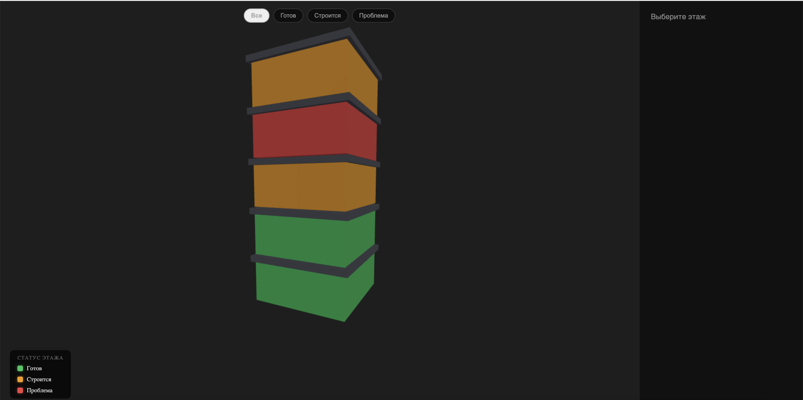
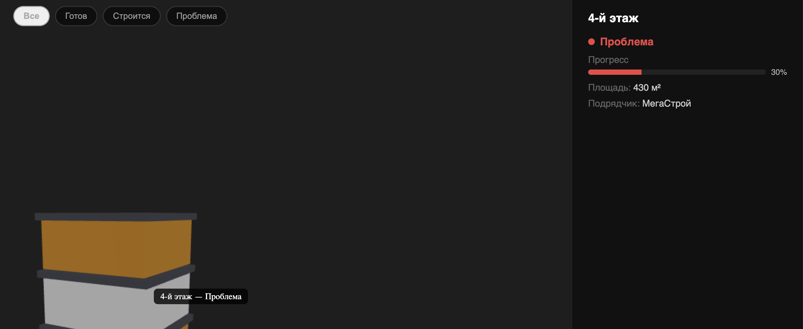
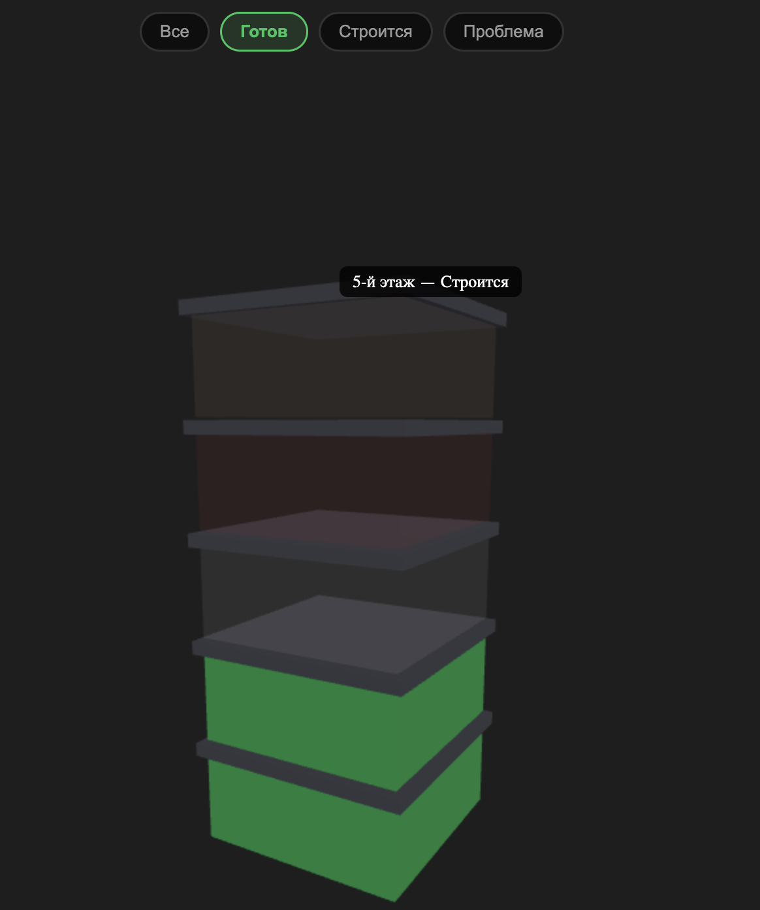
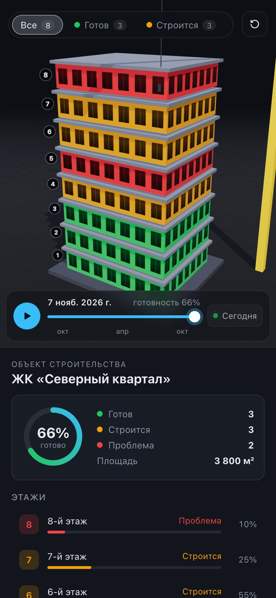

# 3D-визуализатор здания

[](https://github.com/vladislavprozorov/sber-three-react/actions/workflows/deploy.yml)

Демо: [https://vladislavprozorov.github.io/sber-three-react/](https://vladislavprozorov.github.io/sber-three-react/)

---

## Скриншоты

<table>
  <tr>
    <td align="center" width="50%">
      
      <br/>
      <sub>Основной вид — здание с перекрытиями</sub>
    </td>
    <td align="center" width="50%">
      
      <br/>
      <sub>Выбранный этаж — панель с данными и прогрессом</sub>
    </td>
  </tr>
  <tr>
    <td align="center" width="50%">
      
      <br/>
      <sub>Фильтр по статусу — подсветка нужных этажей</sub>
    </td>
    <td align="center" width="50%">
      
      <br/>
      <sub>Мобильный вид — вертикальный layout</sub>
    </td>
  </tr>
</table>

---

## О проекте

Интерактивная 3D-визуализация строящегося здания на React и Three.js.

Проект демонстрирует архитектурное разделение между движком визуализации (Three.js) и логическим слоем приложения (React) — по аналогии с системами управления строительными проектами.

```
Клик пользователя -> Raycaster -> Этаж выбран
                         |
                 Обновление React state
                         |
              Панель отображает данные этажа
```

---

## Функциональность

**3D-сцена**
- Здание из 8 этажей с процедурной текстурой окон, плитами-перекрытиями и номерами этажей
- Мягкие тени, ACES tone mapping, туман, земля с сеткой и анимированный башенный кран
- Плавные (не зависящие от FPS) анимации подсветки, прозрачности и масштаба этажей
- Камера перелетает к выбранному этажу, сохраняя текущий угол обзора, и автоматически вписывает здание в кадр при любой ширине экрана
- Автовращение в режиме обзора (отключается при взаимодействии и при `prefers-reduced-motion`)
- Клик отличается от перетаскивания камеры — вращение больше не выбирает этаж случайно
- Pointer Events — одинаково работает с мышью и тачем

**Таймлайн стройки**
- Ползунок по истории проекта: здание «растёт» этаж за этажом, статусы и прогресс пересчитываются на любую дату
- Кнопка ▶ проигрывает всю стройку от котлована до сегодняшнего дня, `←`/`→` — шаг в месяц
- Все виды (сцена, фильтр, сводка, план) показывают состояние на выбранную дату

**План этажа**
- При выборе этажа верхние этажи поднимаются, потолок исчезает — видна планировка из 8 квартир с коридором
- Квартиры окрашены по статусу и заполняются в порядке работы бригады; проблемная квартира подсвечена красным
- Синхронный 2D-план в панели: выбор квартиры в 3D или на плане подсвечивает её в обоих местах

**Квартиры изнутри**
- Выбор квартиры (в 3D или на плане) — камера опускается к квартире, и она «вырастает» в детальную модель
- Комнаты по шаблонам 1-, 2- и 3-комнатных квартир: стены с дверными и оконными проёмами, подписи с площадями
- Вид зависит от стадии стройки: разметка на плите → растущие бетонные стены, поддоны с кирпичом и мешки → окна → штукатурка и чистовые полы → мебель (кровати, диваны, кухня, сантехника)
- У проблемных квартир на объекте стоят сигнальные конусы
- Карточка квартиры: план с окнами и входом, экспликация помещений, этапы работ с прогрессом
- Работает вместе с таймлайном: перемотайте время и смотрите, как квартира строится

**Интерфейс**
- Панель объекта: общий прогресс (взвешенный по площади), счётчики статусов, общая площадь
- Список этажей, синхронизированный со сценой: наведение и выбор работают в обе стороны
- Карточка этажа: площадь, рабочие, подрядчик, срок сдачи, описание проблемы; переход к соседнему этажу
- Фильтр по статусу со счётчиками — отфильтрованные этажи становятся «призраками» и не кликаются
- Горячие клавиши: `↑`/`↓` — соседний этаж, `←`/`→` — месяц на таймлайне, `Esc` — выйти из квартиры / общий вид
- Адаптивная вёрстка: container queries для оверлеев сцены, вертикальный стек на мобильных

**Надёжность**
- Отмена устаревших запросов (`AbortController`) и кэш загруженных этажей — при быстром переключении панель не покажет чужие данные
- Полная очистка WebGL-ресурсов: геометрии, материалы, текстуры, `requestAnimationFrame`
- three.js вынесен в отдельный чанк для лучшего кэширования
- CI/CD — автоматический деплой на GitHub Pages при каждом пуше в main

---

## Стек технологий

| Слой   | Технологии                         |
| ------ | ---------------------------------- |
| UI     | React 19, TypeScript, CSS          |
| 3D     | Three.js, OrbitControls, Raycaster |
| Сборка | Vite                               |
| CI/CD  | GitHub Actions, GitHub Pages       |

---

## Архитектура

```
src/
  app/
    App.tsx                      # Корневой компонент — только разметка
    hooks/
      useBuildingViewer.ts       # Выбор этажа/квартиры, наведение, фильтр, клавиатура
      useTimeline.ts             # Дата таймлайна, проигрывание, снимок здания
  features/
    building-3d/
      BuildingScene.ts           # Императивный Three.js-движок (без React)
      ThreeScene.tsx             # Тонкая React-обёртка над BuildingScene
      StatusFilter.tsx           # Фильтр по статусу
      StatusLegend.tsx           # Подсказка по управлению
      apartmentInterior.ts       # Процедурный 3D-интерьер квартиры по стадии стройки
    apartment/
      apartmentLayout.ts         # Планировки квартир, стены, проёмы, этапы работ
      ApartmentCard.tsx          # Карточка квартиры: план, экспликация, этапы
    building-info/
      BuildingInfoPanel.tsx      # Сводка, карточка этажа, список этажей
      FloorPlan.tsx              # Интерактивный 2D-план квартир (SVG)
      hooks/useFloorDetails.ts   # Загрузка деталей с кэшем и отменой
      floorService.ts            # Mock API, история стройки, планировка, getFloorsAt(date)
    timeline/
      Timeline.tsx               # Ползунок времени и кнопка проигрывания
  index.css                      # Дизайн-токены и стили
```

- `BuildingScene` ничего не знает о React: принимает состояние через сеттеры (`setSelected`, `setHovered`, `setFilter`) и сообщает о событиях через коллбэки — его можно переиспользовать в любом фреймворке
- Единый источник правды — `useBuildingViewer`; сцена и панель только отображают состояние и отправляют намерения
- `getFloorsAt(date)` — чистая функция: снимок здания на дату, на ней построены таймлайн и план
- `floorService` — слой данных, который можно заменить реальным REST API без изменений в UI

---

## Запуск

```bash
npm install
npm run dev
```

Сборка для продакшена:

```bash
npm run build
```

---

## История веток

| Ветка                       | Описание                                                |
| --------------------------- | ------------------------------------------------------- |
| `feature/enhance-3d-viewer` | Mock API, статусные цвета, hover-тултип, lerp камеры    |
| `feature/status-legend`     | Легенда статусов поверх сцены                           |
| `feature/orbit-controls`    | OrbitControls с затуханием                              |
| `feature/floor-slabs`       | Плиты-перекрытия между этажами                          |
| `feature/status-filter`     | Кнопки-фильтры по статусу                               |
| `feature/mobile-layout`     | Адаптивный layout, хуки useIsMobile и useBuildingViewer |
